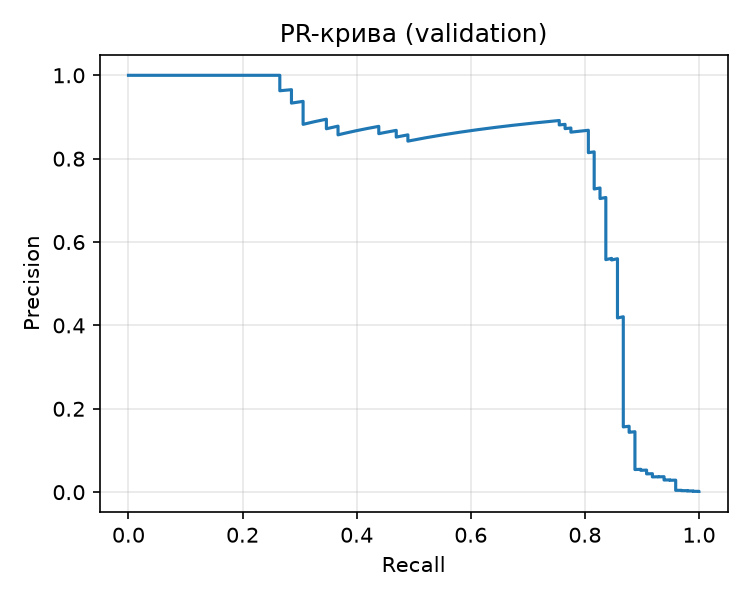
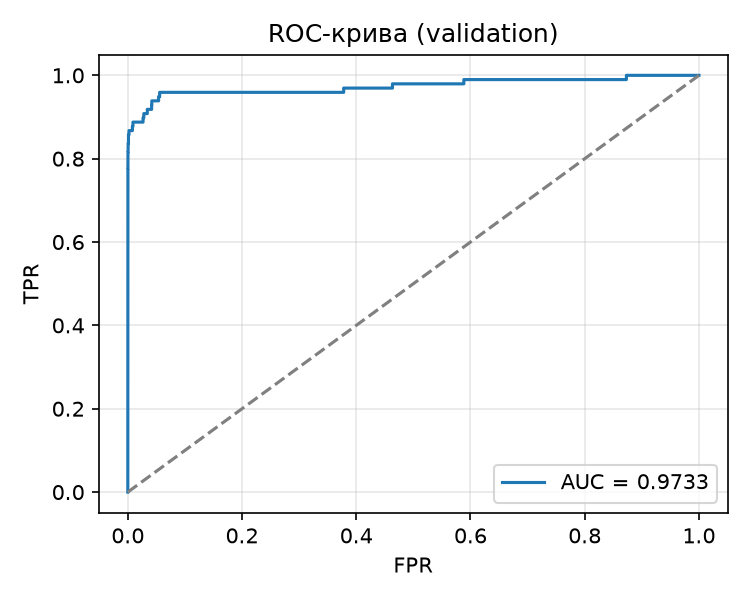

# ЛР2. Поріг рішення під асиметричну ціну помилок

Бінарна класифікація шахрайських транзакцій на датасеті **Credit Card Fraud Detection**
(284 807 транзакцій, з них 492 шахрайські). Модель `Linear(29, 32) → ReLU → Linear(32, 1)`
навчається на CPU у `float32` **один раз** і далі не змінюється. Підбирається лише
**поріг рішення** `t` під вартість помилок `C = 10·FN + FP`: пошук порога на validation
реалізовано вручну (сортування та кумулятивні суми), перевірено прямим перебором на трьох
малих наборах, а потім один раз застосовано до test.

---

## Зміст

1. [Структура репозиторію](#1-структура-репозиторію)
2. [Відтворення результатів](#2-відтворення-результатів)
3. [Дані та поділ](#3-дані-та-поділ)
4. [Метрики та вартість помилок](#4-метрики-та-вартість-помилок)
5. [Вибір порога на validation](#5-вибір-порога-на-validation)
6. [Перевірка пошуку порога](#6-перевірка-пошуку-порога)
7. [Тестова оцінка та аналіз помилок](#7-тестова-оцінка-та-аналіз-помилок)
8. [Висновки](#8-висновки)
9. [Використані зовнішні інструменти та джерела](#9-використані-зовнішні-інструменти-та-джерела)

---

## 1. Структура репозиторію

| Файл / тека | Призначення |
|---|---|
| `README.md` | цей звіт: формули, таблиці результатів, висновки |
| `pyproject.toml` | залежності проєкту (керується `uv`) |
| `uv.lock` | застиглий файл залежностей для точного відтворення оточення |
| `lab2_starter.py` | поділ даних, навчання моделі, збереження прогнозів (надав викладач) |
| `thresholds.py` | `TP/FP/FN/TN`, `C`, швидкий пошук порога та прямий перебір |
| `analyze.py` | пп. 2–4: validation, перевірки A/B/C, test, розбір помилок |
| `results/` | `model.pt`, `predictions.npz`, `preprocessing.npz`, `run.json`, `split_summary.csv` |
| `analysis/` | криві, таблиця кандидатів, результати перевірок, помилки, `results.json`, `analysis_log.txt` |

```
lab2/
├── README.md
├── pyproject.toml
├── uv.lock
├── lab2_starter.py
├── thresholds.py
├── analyze.py
├── results/
│   ├── model.pt
│   ├── predictions.npz
│   ├── preprocessing.npz
│   ├── run.json
│   └── split_summary.csv
└── analysis/
    ├── validation_thresholds.csv    # повна таблиця кандидатів
    ├── validation_summary.csv       # 0.5 / t* / +inf
    ├── pr_curve.png
    ├── roc_curve.png
    ├── check_A.csv, check_B.csv, check_C.csv, checks_summary.csv
    ├── test_errors.csv
    ├── results.json
    └── analysis_log.txt
```

---

## 2. Відтворення результатів

Файл `creditcard.csv` у репозиторій **не входить** (`.gitignore`). Його потрібно завантажити
з [Kaggle](https://www.kaggle.com/datasets/mlg-ulb/creditcardfraud) (потрібен обліковий запис)
та передати шлях до локальної копії аргументом `--data`.

```bash
cd lab2
uv sync                                                              # залежності за uv.lock

# 1) навчання (один раз; тека results має бути відсутня або порожня)
uv run python lab2_starter.py --data creditcard.csv --out results

# 2) аналіз зі збережених прогнозів, без навчання і без CSV
uv run python analyze.py --saved results --out analysis
```

Друга команда відтворює всі числа цього звіту (поріг `t*`, лічильники, `C`, таблицю помилок).
Повторне навчання дає той самий поділ і ті самі статистики стандартизації; оцінки після
навчання можуть відрізнятися в молодших розрядах (залежність від версії бібліотеки й платформи).

Середовище, у якому отримано результати (`results/run.json`):

| Компонент | Версія |
|---|---|
| Python | 3.12.14 |
| NumPy | 2.5.3 |
| pandas | 3.0.6 |
| scikit-learn | 1.9.1 |
| PyTorch | 2.14.1+cpu (CPU, `float32`, 4 потоки) |

---

## 3. Дані та поділ

| Параметр | Значення |
|---|---|
| Джерело | Kaggle, `creditcard.csv` |
| Розмір датасету | 284 807 обʼєктів, 492 шахрайські (≈ 0,173 %) |
| Ознаки | 29: `V1`–`V28` і `Amount` |
| Не входять у модель | `Class` (ціль) і `Time` |
| Сирий `Amount` | збережено окремо для аналізу помилок |
| Поділ train / validation / test | 60 / 20 / 20, стратифікований за `Class`, початковий порядок рядків CSV збережено |
| Метод поділу | `train_test_split(test_size=0.4, stratify=Class, random_state=0)`; відкладені індекси діляться навпіл (`test_size=0.5`, стратифікація за відповідними мітками, `random_state=0`): перша частина — validation, друга — test |
| Стандартизація | `StandardScaler`, навчений **лише на train**, ті самі статистики застосовано до validation і test |
| Балансування класів | не застосовується |

Склад вибірок (`results/split_summary.csv`):

| Вибірка | Обʼєктів | Шахрайських | Частка шахрайських |
|---|---|---|---|
| train | 170 884 | 295 | 0,1726 % |
| validation | 56 961 | 98 | 0,1720 % |
| test | 56 962 | 99 | 0,1738 % |

Частка шахрайських транзакцій майже однакова в усіх трьох вибірках, тобто стратифікація
спрацювала.

**Чому статистики стандартизації не можна обчислювати на всьому наборі.** Якби середнє та
стандартне відхилення рахувалися на всіх даних, до масштабування потрапила б інформація
з validation і test. Це **витік даних**: preprocessing «бачить» вибірки, на яких пізніше
обирається поріг і оцінюється модель. Оцінки стають оптимістичними, а test перестає бути
незалежним. Тому `mean` і `scale` беруться лише з train (`results/preprocessing.npz`).

### Модель і навчання

```
X (29) → Linear(29, 32) → ReLU → Linear(32, 1) → логіт z,   s = sigmoid(z)
```

| Параметр | Значення |
|---|---|
| Функція втрат | `BCEWithLogitsLoss`, середнє за пакетом, без зважування класів |
| Оптимізатор | Adam, `lr = 1e-3`, решта параметрів за замовчуванням |
| Навчання | 12 епох, пакет 1024, останній неповний пакет не відкидається |
| Відтворюваність | `torch.manual_seed(0)`; перемішування train через `np.random.default_rng(0)`, нова перестановка на кожній епосі |
| Ваги | після 12-ї епохи, епоха за validation не вибиралась |

BCE на train: 0,3653 (епоха 1) → 0,0549 → 0,0170 → … → **0,00338** (епоха 12), без збоїв.
Для validation і test оцінки `s = sigmoid(z)` отримано в режимі `eval()` без обчислення
градієнтів і збережено без округлення в `results/predictions.npz` разом з мітками, номерами
рядків CSV і сирим `Amount`.

---

## 4. Метрики та вартість помилок

Правило прогнозу при порозі `t`: **шахрайство, якщо `s ≥ t`**.

| Позначення | Значення |
|---|---|
| `TP` | шахрайство, спрогнозоване як шахрайство |
| `FP` | легітимна транзакція, спрогнозована як шахрайство (хибна тривога) |
| `FN` | шахрайство, яке пропущено |
| `TN` | легітимна транзакція, спрогнозована як легітимна |

```
C(t)      = 10 · FN(t) + FP(t)         # пропущене шахрайство вдесятеро дорожче за хибну тривогу
precision = TP / (TP + FP)
recall    = TP / (TP + FN)
```

`Amount` у формулу вартості не входить. Якщо знаменник нульовий (немає жодного
позитивного прогнозу для precision або жодного справжнього позитиву для recall), метрика
**не визначена** — ділення на нуль; у коді це `NaN`.

У `thresholds.py` лічильники реалізовано двічі: `confusion` — прямий цикл по обʼєктах
(для перевірки), `confusion_fast` — векторизовано (для довільного порога на великій вибірці).

---

## 5. Вибір порога на validation

### Алгоритм пошуку

Кандидати: **усі унікальні оцінки validation та `+∞`**. Поріг `+∞` означає «усі негативні»,
найменша оцінка — «усі позитивні». Рівні оцінки завжди отримують однаковий прогноз.

```
1. order  = argsort(-s)                        # оцінки за спаданням
2. cum_TP = cumsum(y[order]),  cum_FP = cumsum(1 - y[order])
3. ends   = індекси, де s_sorted[i] != s_sorted[i+1], та останній    # кінці груп рівних оцінок
4. t = s_sorted[ends],  TP = cum_TP[ends],  FP = cum_FP[ends]
5. FN = P - TP,  TN = N - FP                   # P, N — кількість позитивів і негативів
6. додати кандидата +inf:  TP = FP = 0,  FN = P,  TN = N
7. C = 10 * FN + FP                            # для всіх кандидатів одразу
```

Складність — `O(n log n)`, де `n` — розмір validation; для кожного порога окремого проходу
по вибірці немає. Значення береться в **кінці групи рівних оцінок**, бо поріг, рівний оцінці,
вмикає в прогноз усю групу одразу.

Вибір: мінімум `C`; **якщо мінімум досягається на кількох порогах — береться найбільший**.
Результат позначено `t*`. Повну таблицю кандидатів (поріг, `TP`, `FP`, `FN`, `TN`, `C`;
55 942 рядки) збережено в `analysis/validation_thresholds.csv`.

```
t* = 0.03119400516152382
```

### Порівняння правил на validation

| Правило на validation | Поріг | TP | FP | FN | TN | C |
|---|---|---|---|---|---|---|
| Стандартний поріг | 0,5 | 71 | 9 | 27 | 56 854 | 279 |
| Мінімум вартості | `t*` ≈ 0,0312 | 82 | 34 | 16 | 56 829 | **194** |
| Усі негативні | `+∞` | 0 | 0 | 98 | 56 863 | 980 |

(округлено лише для відображення; точні значення — у `analysis/validation_summary.csv`.
У кожному рядку `TP + FN = 98` і `FP + TN = 56 863`.)

При `t*`: precision = 82/116 ≈ 0,707, recall = 82/98 ≈ 0,837.
При `t = 0,5`: precision = 71/80 ≈ 0,888, recall = 71/98 ≈ 0,724.

### Криві та ROC-AUC

```
ROC-AUC (validation) = 0.9733
```

<p align="center">
  
  
</p>

- **PR-крива:** precision ≈ 1,0 до recall ≈ 0,27, далі ≈ 0,85–0,9 до recall ≈ 0,8, після чого
  різко падає (від ≈ 0,8 до ≈ 0,15 в інтервалі recall 0,8–0,87) і прямує до нуля. Точка `t*`
  (recall 0,84, precision 0,71) лежить на початку цього обвалу. Це узгоджується з ціною
  помилок: зниження порога вигідне, доки додатково знайдений шахрай «коштує» менше за 10
  хибних тривог, тобто доки локальна precision вища за `1/11 ≈ 0,09`.
- **ROC-крива:** майже вертикальний підйом до TPR ≈ 0,85 при FPR ≈ 0, TPR ≈ 0,96 при
  FPR ≈ 0,05, далі повільне зростання до 1.

**Чому висока ROC-AUC не гарантує малої вартості помилок чи високої precision.**

1. ROC-AUC оцінює лише **впорядкування** оцінок: імовірність, що випадковий шахрайський
   обʼєкт отримає більшу оцінку, ніж випадковий легітимний. Вона не залежить від вибраного
   порога й нічого не знає про ціну помилок (10 : 1).
2. Вона не враховує **дисбаланс класів**: на один шахрайський обʼєкт припадає ≈ 580
   легітимних. При `t*` FPR = 34/56 863 ≈ 0,06 %, але це 34 хибні тривоги проти 82
   справжніх спрацювань, тому precision лише ≈ 0,71. Щоб досягти TPR ≈ 0,96, потрібен
   FPR ≈ 5 %, тобто близько трьох тисяч хибних тривог.
3. Дві моделі з однаковою AUC можуть мати різну мінімальну `C`: вартість залежить від
   конкретного порога й кількості `FN` та `FP`. Для сильно незбалансованих даних
   інформативнішою є PR-крива.

---

## 6. Перевірка пошуку порога

Для кожного з трьох малих наборів, **незалежно від навченої моделі**, список кандидатів
(унікальні оцінки та `+∞`) побудовано двома способами:

- **швидким** (`fast_table`): сортування та кумулятивні суми;
- **прямим перебором** (`brute_table`): для кожного кандидата правило `s ≥ t` окремо
  застосовується до кожного обʼєкта. Результати швидкого алгоритму не використовуються.

**Критерій:** усі лічильники та вартості збігаються точно, а вибраний поріг відповідає тому
самому правилу розвʼязання нічиєї (за рівної вартості — більший поріг) та очікуваному
значенню, розрахованому вручну.

### Набір A

`s = [0.9, 0.7, 0.7, 0.4, 0.2, 0.1]`, `y = [0, 1, 0, 1, 0, 0]`

| Поріг | TP | FP | FN | TN | C |
|---|---|---|---|---|---|
| 0,1 | 2 | 4 | 0 | 0 | 4 |
| 0,2 | 2 | 3 | 0 | 1 | 3 |
| **0,4** | 2 | 2 | 0 | 2 | **2** |
| 0,7 | 1 | 2 | 1 | 2 | 12 |
| 0,9 | 0 | 1 | 2 | 3 | 21 |
| `+∞` | 0 | 0 | 2 | 4 | 20 |

Обраний поріг: **`t* = 0,4`**. Набір перевіряє **рівні оцінки**: два обʼєкти з `s = 0,7` мають
різні мітки (1 і 0), але завжди отримують однаковий прогноз. Тому кандидата «між ними» не
існує: при `t = 0,7` обидва позитивні, при `t = 0,9` обидва негативні. Алгоритм має брати
кумулятивні суми саме в кінці групи рівних оцінок, інакше таблиці розійшлися б.

### Набір B

`s = [0.9, 0.6, 0.3]`, `y = [0, 0, 0]`

| Поріг | TP | FP | FN | TN | C |
|---|---|---|---|---|---|
| 0,3 | 0 | 3 | 0 | 0 | 3 |
| 0,6 | 0 | 2 | 0 | 1 | 2 |
| 0,9 | 0 | 1 | 0 | 2 | 1 |
| **`+∞`** | 0 | 0 | 0 | 3 | **0** |

Обраний поріг: **`t* = +∞`**. Набір перевіряє **відсутність позитивних міток**: `P = 0`, тому
всі `TP` і `FN` нульові, а кожна хибна тривога лише збільшує вартість. Мінімум можливий
тільки при кандидаті `+∞` («усі негативні»), тому цей кандидат обовʼязково має бути в
списку. Також тут recall не визначений (`TP + FN = 0`).

### Набір C

`s = [0.8, 0.5 × 11, 0.2]`, `y = [1, 1, 0 × 10, 0]`
(одинадцять оцінок 0,5 підряд: перша з міткою 1, решта десять — з міткою 0)

| Поріг | TP | FP | FN | TN | C |
|---|---|---|---|---|---|
| 0,2 | 2 | 11 | 0 | 0 | 11 |
| 0,5 | 2 | 10 | 0 | 1 | **10** |
| **0,8** | 1 | 0 | 1 | 11 | **10** |
| `+∞` | 0 | 0 | 2 | 11 | 20 |

Обраний поріг: **`t* = 0,8`**. Набір перевіряє **два кандидати з однаковою вартістю**:
`C(0,5) = C(0,8) = 10`. За правилом розвʼязання нічиєї береться **більший** поріг. Поріг 0,5
вимагає 10 хибних тривог заради одного додатково виявленого шахрайства, а 0,8 не додає
жодної хибної тривоги — за рівної вартості обирається менш агресивне правило.

### Підсумок перевірок

| Набір | Таблиці швидкий vs перебір | `t*` швидкий | `t*` перебір | `t*` очікуваний | Перевірку пройдено |
|---|---|---|---|---|---|
| A | збігаються | 0,4 | 0,4 | 0,4 | Так |
| B | збігаються | `+∞` | `+∞` | `+∞` | Так |
| C | збігаються | 0,8 | 0,8 | 0,8 | Так |

До тестової оцінки перейшли лише після проходження всіх трьох перевірок (у `analyze.py`
це забезпечено порядком виконання: у разі невдачі тест не оцінюється).

---

## 7. Тестова оцінка та аналіз помилок

Поріг `t* = 0.03119400516152382` зафіксований на validation. Результати test **не
використовувались** для зміни порога, моделі чи налаштувань навчання.

| TP | FP | FN | TN | C | precision | recall |
|---|---|---|---|---|---|---|
| 80 | 43 | 19 | 56 820 | **233** | 0,6504 (80/123) | 0,8081 (80/99) |

Знаменники ненульові (`TP + FP = 123`, `TP + FN = 99`), тому обидві метрики визначені.
Довідково (поріг за цим не вибирався): при `t = 0,5` на test `C = 288` (TP 71, FP 8,
FN 28); при `t = +∞` — `C = 990`.

### Перші п'ять FP і п'ять FN за номером рядка CSV

Номери рядків від 0, без заголовка (`analysis/test_errors.csv`).

| Рядок CSV | Тип помилки | Мітка | Оцінка | Amount | Оцінка − `t*` |
|---|---|---|---|---|---|
| 460 | FP | 0 | 0,1962 | 2,00 | +0,1650 |
| 2961 | FP | 0 | 0,0810 | 2,49 | +0,0498 |
| 10783 | FP | 0 | 0,9663 | 89,99 | +0,9351 |
| 13405 | FP | 0 | 0,9320 | 89,99 | +0,9008 |
| 13617 | FP | 0 | 0,9228 | 89,99 | +0,8916 |
| 10497 | FN | 1 | 0,0115 | 3,79 | −0,0197 |
| 52521 | FN | 1 | 0,0064 | 105,99 | −0,0248 |
| 55401 | FN | 1 | 0,0056 | 1,00 | −0,0256 |
| 91671 | FN | 1 | 0,0005 | 290,18 | −0,0307 |
| 93486 | FN | 1 | 0,0184 | 0,00 | −0,0128 |

**Порівняння `Amount` та відстані від порога.**

- Три з п'яти FP мають однакову суму 89,99 і дуже високі оцінки (0,92–0,97), тобто лежать
  далеко над порогом: модель впевнено вважає їх шахрайством. Решта FP — малі суми
  (2,00 і 2,49) з оцінками ближче до порога.
- Усі п'ять FN лежать нижче порога лише на 0,013–0,031, але це частково артефакт: через малий
  `t*` та невідʼємність оцінок різниця `t* − s` для будь-якого FN не може перевищити 0,031.
  Самі оцінки мізерні (0,0005–0,018), тобто це впевнені «ні», а не граничні випадки.
- Суми серед FN різні (від 0,00 до 290,18); чіткої залежності типу помилки від `Amount` не видно.

**Чи можна за десятьма прикладами судити про причину помилок моделі?** Ні. Це десять із 62
помилок на test (43 FP + 19 FN), до того ж не випадкових, а перших за номером рядка, тому
вибірка може бути зсунутою. Повторення суми 89,99 — лише привід для подальшого аналізу, а не
доказ причини. Для висновків потрібен аналіз усіх помилок, розподілів `Amount` та ознак,
порівняння з правильно класифікованими прикладами.

---

## 8. Висновки

**Що змінив вибір порога в роботі незмінної моделі.** Ваги та оцінки лишилися тими самими,
змінилося тільки правило рішення. Перехід від `t = 0,5` до `t* ≈ 0,0312` зробив прогноз
агресивнішим: на validation `FN` зменшилося з 27 до 16, `FP` зросло з 9 до 34, а вартість
впала з 279 до 194 (−85, ≈ −30 %). Порівняно з правилом «усі негативні» (`C = 980`) виграш
ще більший.

**Яка ціна цього рішення.** На test `FN` зменшилося з 28 до 19 (−9, тобто −90 до вартості),
але `FP` зросло з 8 до 43 (+35): `C` впала з 288 до 233 (−55, ≈ −19 %). Тобто за кожне
додатково виявлене шахрайство довелося заплатити приблизно чотирма додатковими хибними
тривогами (35/9 ≈ 3,9), що вигідно при співвідношенні цін 10 : 1. Precision при цьому впала
з 0,90 (`t = 0,5`) до 0,65, а recall зріс з 0,72 до 0,81.

**Чому результат на validation не гарантує такого самого виграшу на test.**

1. `t*` вибрано як мінімум серед ≈ 56 тисяч кандидатів саме на validation, тож оцінка
   вартості там **оптимістично зсунута**: ми обрали найкращий поріг для цієї конкретної
   вибірки разом з її випадковістю.
2. Позитивів мало (98 на validation і 99 на test), тому кілька обʼєктів помітно змінюють
   `FN`, `C` та положення оптимуму.
3. Validation і test — різні скінченні вибірки: кількості `FP` і `FN` на них відрізняються
   випадково, тож виграш на test (−55) вийшов меншим, ніж на validation (−85).

---

## 9. Використані зовнішні інструменти та джерела

**Джерела**
- Матеріали лецій 3 і 4 з курси "Системи глибинного навчання"
- Стартовий код `lab2_starter.py` (поділ даних, навчання, збереження прогнозів) надав викладач.
- Для побудови кривих використано функції scikit-learn (`precision_recall_curve`, `roc_curve`, `roc_auc_score`).
- Датасет: Machine Learning Group, ULB. Credit Card Fraud Detection. Kaggle: https://www.kaggle.com/datasets/mlg-ulb/creditcardfraud
- Документація uv (керування залежностями та lock-файлом): https://docs.astral.sh/uv/
- Claude (Anthropic)


