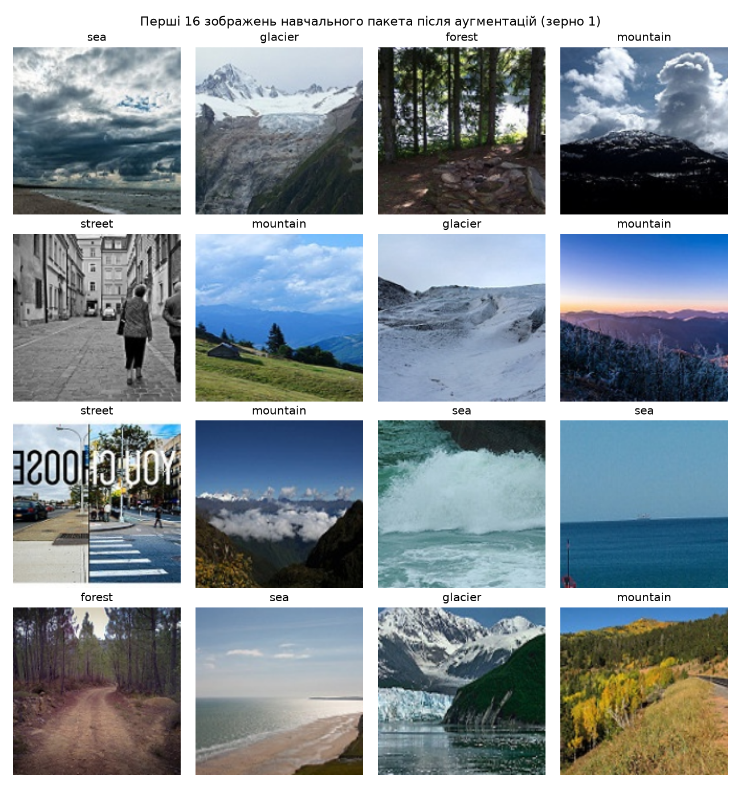
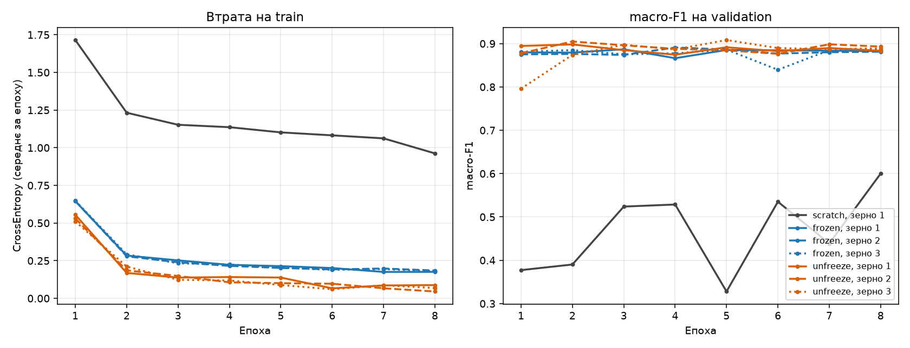
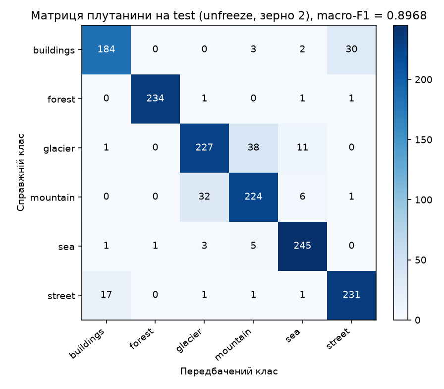
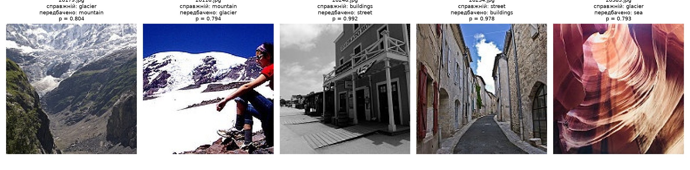

# ЛР3. Обчислювальний експеримент і трансферне навчання

Порівняння трьох режимів навчання **ResNet-18** на малій вибірці (1200 навчальних зображень, 6 класів) за однакового
бюджету в **304 кроки оптимізатора** (8 епох × 38 пакетів): `scratch` (випадкові ваги, навчається все), `frozen`
(ваги ImageNet, навчається лише `fc`) і `unfreeze` (ваги ImageNet, навчаються `layer4` і `fc`). Датасет — Intel Image
Classification (`seg_train` 14 034 і `seg_test` 3 000 зображень, `seg_pred` не використовується). Питання роботи: яку
частину виграшу дають попередньо навчені ознаки, яку — донавчання кістяка і чи більша кожна з цих різниць за розкид між
запусками.

**Коротко.** Попереднє навчання дає **+28,35 п.** macro-F1 (frozen 0,8836 проти scratch 0,6000), що набагато більше за
поріг шуму R = 0,0097. Розморожування `layer4` дає лише **+0,52 п.** (0,8887 проти 0,8836), що **не перевищує R** —
результату немає. Вибраний запуск (unfreeze, зерно 2) на test: macro-F1 **0,8968**.

---

## Зміст

1. [Структура репозиторію](#1-структура-репозиторію)
2. [Відтворення результатів](#2-відтворення-результатів)
3. [Дані та поділ](#3-дані-та-поділ)
4. [Модель, режими та протокол](#4-модель-режими-та-протокол)
5. [Перевірки до навчання](#5-перевірки-до-навчання)
6. [Сім запусків](#6-сім-запусків)
7. [Розклад ефектів](#7-розклад-ефектів)
8. [Вибір конфігурації та тестова оцінка](#8-вибір-конфігурації-та-тестова-оцінка)
9. [Висновок](#9-висновок)
10. [Відхилення від умови та відповідність вимогам](#10-відхилення-від-умови-та-відповідність-вимогам)
11. [Використані зовнішні інструменти та джерела](#11-використані-зовнішні-інструменти-та-джерела)

---

## 1. Структура репозиторію

| Файл / тека | Призначення |
|---|---|
| `README.md` | цей звіт |
| `pyproject.toml`, `uv.lock`, `.python-version` | залежності із зафіксованими версіями (`uv`) і Python 3.12 |
| `config.py` | усі зафіксовані налаштування: класи, перетворення, гіперпараметри, контрольні числа |
| `split.py` | побудова `split.csv` за процедурою з умови й перевірка за контрольною таблицею |
| `data.py` | датасет за `split.csv`, перетворення, завантажувачі |
| `model.py` | побудова моделі, режими, групи оптимізатора, `set_train_mode` |
| `engine.py` | цикл навчання, логіти, macro-F1, повний запуск і `run.json` |
| `checks.py` | перевірки пп. 1–2 (пакет, L0, параметри, зміни модулів, дослід із BN) |
| `selection.py` | правило вибору конфігурації та розклад ефектів |
| `utils.py` | хеші, git, версії, пристрій, запис файлів |
| `train.py` | **команда навчання**: поділ, перевірки, сім запусків, вибір, `lab3_model.pt` (test не використовує) |
| `test_eval.py` | тестова оцінка; імпортується лише з `analyze.py` |
| `analyze.py` | **команда аналізу**: перевірка хешу, таблиця, криві, ефекти, перевірка вибору, test, матриця, помилки |
| `split.csv` | поділ даних (`file`, `label`, `part`) |
| `runs/<режим>_seed<зерно>/` | `run.json` і `val_logits.npy` кожного з семи запусків (локальні `model.pt` у репозиторій не входять) |
| `lab3_model.pt` | ваги вибраного запуску (≈ 45 МБ, у межах ліміту GitHub) |
| `results/` | `split_check.md`, `initial_loss.md`, `param_table.md`, `module_changes.md`, `bn_experiment_prediction.md`, `bn_experiment.md`, `analysis.md`, `analysis.json`, `conclusion_draft.md`, `test_logits.npy` |
| `figures/` | `batch.png`, `curves.png`, `confusion.png`, `errors.png` |

---

## 2. Відтворення результатів

Набір даних у репозиторій **не входить** (`.gitignore`). Його потрібно завантажити з Kaggle
([Intel Image Classification](https://www.kaggle.com/datasets/puneet6060/intel-image-classification)), розпакувати й
передати шлях до теки `archive` (у ній `seg_train`, `seg_test`, `seg_pred`) аргументом `--data`.

```bash
cd lab3
uv sync                                          # залежності за uv.lock

# 1) навчання: поділ, перевірки пп. 1-2, сім запусків, журнали, вибір, lab3_model.pt (test не використовується)
uv run python train.py --data path/to/archive

# 2) аналіз: хеш split.csv, таблиця, криві, ефекти, перевірка вибору, test, матриця, п'ять помилок
uv run python analyze.py --data path/to/archive
```

Під час першого запуску `torchvision` завантажує ваги ImageNet (потрібен інтернет). Якщо навчання перервалося,
`train.py --resume` пропускає запуски, завершені на тому самому `split.csv`. Усі тестові числа цього звіту взято з виводу
`analyze.py` (`results/analysis.md`, `results/analysis.json`).

Середовище, у якому отримано результати (`runs/*/run.json`):

| Компонент | Версія |
|---|---|
| Python | 3.12.14 |
| PyTorch | 2.15.0+cpu |
| torchvision | 0.29.2+cpu |
| NumPy | 2.5.4 |
| scikit-learn | 1.9.1 |
| Pillow | 13.0.0 |
| Пристрій навчання | CPU (Intel64 Family 6 Model 140 Stepping 1, GenuineIntel), `float32` |
| Пристрій test | CPU, `float32` |

Усі сім запусків виконано з одного коміту `974c5d391d9c624e53fcd463e502f524fe972dec` без незакомічених змін (хеші комітів і позначки з `run.json` усіх
семи запусків збігаються).

Числа macro-F1 можуть відрізнятися на іншій машині чи версії бібліотек; поділ, конфігурація й відповіді «так / ні» в
перевірках п. 2 мають відтворюватися точно.

---

## 3. Дані та поділ

| Параметр | Значення |
|---|---|
| Класи (фіксований порядок) | buildings, forest, glacier, mountain, sea, street (індекси 0–5) |
| Використані теки | `seg_train/seg_train/<клас>` (14 034 файли) і `seg_test/seg_test/<клас>` (3 000 файлів); `seg_pred` не використовується |
| Читання | Pillow, `.convert("RGB")`; 55 зображень менших за висотою не відкидаються — розмір вирівнюють перетворення |
| train | по 200 на клас, разом 1200: один `np.random.default_rng(0)` на всі класи по черзі, `idx = arange(n_k)`, `rng.shuffle(idx)`, береться `idx[:200]` за списком імен, відсортованим як рядки |
| validation / test | новий `default_rng(0)` на всі класи `seg_test` по черзі: `idx[:n_k // 2]` → validation, `idx[n_k // 2:]` → test |
| Файл поділу | `split.csv` (`file`, `label`, `part`, 4200 рядків); далі всі дані завантажуються лише за ним |

**Контроль поділу** (кількість / сума числових імен файлів; `results/split_check.md`):

| Клас | train | validation | test |
|---|---|---|---|
| buildings | 200 / 1 996 761 ✓ | 218 / 4 837 323 ✓ | 219 / 4 837 559 ✓ |
| forest | 200 / 2 032 625 ✓ | 237 / 5 276 962 ✓ | 237 / 5 291 326 ✓ |
| glacier | 200 / 2 183 923 ✓ | 276 / 6 135 652 ✓ | 277 / 6 157 250 ✓ |
| mountain | 200 / 1 950 345 ✓ | 262 / 5 789 535 ✓ | 263 / 5 849 765 ✓ |
| sea | 200 / 1 987 613 ✓ | 255 / 5 655 068 ✓ | 255 / 5 668 011 ✓ |
| street | 200 / 1 841 817 ✓ | 250 / 5 541 845 ✓ | 251 / 5 547 533 ✓ |
| **Разом** | 1200 / 11 993 084 ✓ | 1498 / 33 236 385 ✓ | 1502 / 33 351 444 ✓ |

**Усі 18 клітинок і підсумки збігаються з контрольною таблицею.** Файлів, що входять у дві частини одночасно, — **0**
(перевірено за іменами файлів, які в наборі унікальні). Також перед поділом перевіряється кількість файлів у наборі:
14 034 у `seg_train` і 3 000 у `seg_test`.

SHA-256 `split.csv`: `8407b14dde8eca5816a9f3e34347be54ea19c4a9a35163cb2bf7507a045279d9` — однаковий у всіх семи
журналах і збігається з поточним файлом (це перевіряє `analyze.py`).

---

## 4. Модель, режими та протокол

Кожен запуск будує модель так: `torch.manual_seed(seed)` і `np.random.seed(seed)` → `resnet18(weights=W)` →
`fc = Linear(512, 6)` (стандартна ініціалізація) → `requires_grad=False` для всіх параметрів, крім навчальних → пристрій
і оптимізатор (у нього передаються лише параметри з `requires_grad=True`).

| Режим | Ваги | Навчається | Параметрів | Групи AdamW (швидкість навчання) | У `eval()` під час навчання |
|---|---|---|---|---|---|
| scratch | випадкові | уся мережа | 11 179 590 | усі параметри, 3·10⁻³ | — |
| frozen | ImageNet | `fc` | 3 078 | `fc`, 3·10⁻³ | conv1, bn1, layer1–layer4 |
| unfreeze | ImageNet | `layer4`, `fc` | 8 396 806 | `fc`, 3·10⁻³; `layer4`, 3·10⁻⁴ | conv1, bn1, layer1–layer3 |

Решта налаштувань:

- `AdamW(weight_decay=1e-4)` у всіх групах, інші аргументи за замовчуванням; `CrossEntropyLoss()` із середнім за пакетом;
  BN за замовчуванням (`momentum=0.1`, `eps=1e-5`).
- Перетворення train: `RandomResizedCrop(160, scale=(0.7, 1.0))` → `RandomHorizontalFlip()` → `ToTensor()` →
  `Normalize(mean, std)`; validation і test: `Resize((160, 160))` → `ToTensor()` → `Normalize(mean, std)`;
  `mean = (0,485; 0,456; 0,406)`, `std = (0,229; 0,224; 0,225)` (ті самі й у scratch).
- Завантажувач train: `batch_size=32`, `shuffle=True`, `drop_last=False`, `num_workers=0`, без власного `generator` і
  `sampler` (випадковість із глобального генератора, засіяного на кроці 1); validation і test: `batch_size=64`,
  без перемішування, порядок як у `split.csv`.
- Бюджет: 8 епох × ⌈1200/32⌉ = 38 кроків = **304 кроки**, останній пакет епохи містить 16 зображень. Втрата епохи —
  `Σ_b L_b·|b| / 1200`, де `L_b` — втрата пакета до кроку оптимізатора.
- `set_train_mode(model, regime)` (у `model.py`): `model.train()`, потім `.eval()` для кожного модуля зі стовпця «У eval()».
  Після кожної епохи — `model.eval()`, `torch.no_grad()`, логіти validation і macro-F1 (`sklearn.metrics.f1_score`,
  `average="macro"`).
- Не використовуються: розклади швидкості навчання, обрізання градієнта, змішана точність, згладжування міток, ваги класів,
  рання зупинка, вибір епохи чи контрольної точки за validation. Використовуються ваги **після 8-ї епохи**.
- Журнал `run.json` кожного запуску містить зерно, усі налаштування (включно з тими, що за замовчуванням), хеш коміту й
  позначку про незакомічені зміни, SHA-256 `split.csv`, версії Python/PyTorch/torchvision, пристрій, втрату на train і
  macro-F1 на validation за кожну епоху, час навчання; поруч лежить `val_logits.npy` (1498 × 6).

---

## 5. Перевірки до навчання

Перевірки пп. 1–2 не є навчальними запусками протоколу: моделі після 5 перевірочних кроків не оцінюються на validation,
не зберігаються й не входять у таблицю розділу 6. Кожна перевірка починається з нового екземпляра моделі за кроками 1–5
зі зерном 1. До основного експерименту `train.py` переходить лише після того, як перевірки параметрів і зміни модулів
збіглися з очікуваним (обидві — «так»).

### 5.1. Пакет після перетворень



Показано перші 16 зображень першого навчального пакета (зерно 1) після аугментацій, з оберненим нормуванням і мітками
над кадрами. Підписи відповідають вмісту (sea — море й хвилі, glacier — сніг і лід, street — вулиці). Видно різні
кадрування `RandomResizedCrop` і дзеркальні відображення: у третьому ряду зліва напис на вулиці відображено дзеркально.

### 5.2. Початкова втрата

Модель за кроками 1–5 зі зерном 1, перший пакет навчального завантажувача, після `set_train_mode`, під `torch.no_grad()`,
до жодного кроку оптимізатора:

| Режим | L0 | ln 6 | L0 − ln 6 |
|---|---|---|---|
| scratch | 2,1344 | 1,7918 | +0,3427 |
| frozen | 2,2155 | 1,7918 | +0,4238 |

Обидві початкові втрати **вищі** за `ln 6 = 1,7918` (втрата моделі, що дає всім шести класам однакову ймовірність 1/6).
Пояснення: нова голова `fc` ініціалізована випадково, тому її логіти ненульові й різні для різних класів. Навчальна
вибірка збалансована (по 200 на клас), тож для голови, не пов'язаної з мітками, очікувана втрата приблизно дорівнює
`ln 6 + KL(u ‖ p)`, де `u` — рівномірний розподіл, а `p` — передбачений; вона перевищує `ln 6` на величину відхилення
`p` від рівномірного. Крім того, пакет із 32 зображень малий, а мітки в ньому розподілені нерівномірно.
Припущення (окремо не перевірялося): у frozen відхилення більше, бо ознаки ImageNet на вході `fc` невід'ємні й мають
більшу норму, ніж ознаки випадкової мережі в scratch, і випадкова голова дає ширший розкид логітів; різниця 0,08 між
режимами, виміряна на одному пакеті, сама по собі не є надійною. Відхилення порядку десятих — норма; значення, що на
порядок більше за `ln 6` або NaN, указувало б на помилку в нормуванні чи побудові моделі. Значення frozen L0 = 2,2155
збігається з втратою першого кроку правильного варіанта в досліді з BN (п. 5.5) — це той самий пакет і та сама модель.

### 5.3. Параметри та групи оптимізатора

| Режим | Всього параметрів | `requires_grad=True` | Групи оптимізатора | `requires_grad=False` в оптимізаторі | Збігається з таблицею режимів |
|---|---|---|---|---|---|
| scratch | 11 179 590 | 11 179 590 | all: 11 179 590, lr = 0,003 | жоден | так |
| frozen | 11 179 590 | 3 078 | fc: 3 078, lr = 0,003 | жоден | так |
| unfreeze | 11 179 590 | 8 396 806 | fc: 3 078, lr = 0,003; layer4: 8 393 728, lr = 0,0003 | жоден | так |

Кількість параметрів — сума `numel()`, а не кількість тензорів.

### 5.4. Що змінюється під час навчання

5 кроків оптимізатора на перших 5 пакетах після `set_train_mode`; порівняння повного `state_dict()` (параметри й буфери)
до і після — точне, `torch.equal`:

| Модуль | frozen: параметри | frozen: статистики BN | unfreeze: параметри | unfreeze: статистики BN | Збігається з очікуваним |
|---|---|---|---|---|---|
| conv1 | ні | немає BN | ні | немає BN | так |
| bn1 | ні | ні | ні | ні | так |
| layer1 | ні | ні | ні | ні | так |
| layer2 | ні | ні | ні | ні | так |
| layer3 | ні | ні | ні | ні | так |
| layer4 | ні | ні | **так** | **так** | так |
| fc | так | немає BN | так | немає BN | так |

Модулі зі стовпця «У eval()» заморожені повністю (не змінилися ні параметри, ні ковзні статистики); у решти змінилися
параметри, а в тих, що містять BN, — і статистики. Усі 14 клітинок збігаються з очікуваним.

### 5.5. Дослід із навмисною помилкою (frozen + `model.train()`)

**Прогноз, записаний до запуску** (`results/bn_experiment_prediction.md`): режим frozen, але замість `set_train_mode`
викликається звичайний `model.train()`.

- Параметри заморожених модулів (conv1, bn1, layer1–layer4) **не зміняться**: `requires_grad=False`, і вони не передані в
  оптимізатор.
- Ковзні статистики BN (`running_mean`, `running_var`, `num_batches_tracked`) **зміняться в усьому кістяку**: у режимі
  `train` BN-шар нормує за статистиками пакета й оновлює буфери `running = (1 − momentum)·running + momentum·batch_stat`
  незалежно від `requires_grad`. Параметри `fc` змінюватимуться як завжди.
- З кривої втрати на train помилку діагностувати **не вдасться**: втрата й далі правдоподібно спадатиме, хоч її значення
  на перших кроках можуть помірно відрізнятися через інше нормування. Справжня шкода проявиться в режимі `eval()`:
  там використовуються змінені ковзні статистики, оцінені на малих пакетах нового домену.

**Результат** (нова модель зі зерном 1, ті самі 5 пакетів):

| Модуль | set_train_mode: параметри | set_train_mode: статистики BN | `model.train()`: параметри | `model.train()`: статистики BN | Збіг із прогнозом |
|---|---|---|---|---|---|
| conv1 | ні | немає BN | ні | немає BN | так |
| bn1 | ні | ні | ні | **так** | так |
| layer1 | ні | ні | ні | **так** | так |
| layer2 | ні | ні | ні | **так** | так |
| layer3 | ні | ні | ні | **так** | так |
| layer4 | ні | ні | ні | **так** | так |
| fc | так | немає BN | так | немає BN | так |

Шар `layer1.0.bn1` після 5 кроків (максимальна абсолютна зміна):

| Варіант | max abs Δ `running_mean` | max abs Δ `running_var` | `num_batches_tracked` |
|---|---|---|---|
| `set_train_mode` (правильно) | 0 | 0 | 0 |
| `model.train()` (помилка) | 8,858·10⁻² | 1,484·10⁻¹ | 5 |

Втрати на 5 кроках: `set_train_mode` — 2,2155; 1,6835; 1,7928; 1,4501; 1,2067; `model.train()` — 2,1946; 1,7303; 1,9906;
1,7364; 1,4441.

**Зіставлення з прогнозом.** Прогноз щодо параметрів і буферів підтвердився повністю: параметри кістяка не змінилися, а
статистики всіх п'яти BN-модулів змінилися. Щодо кривої втрати: значення відрізняються (різниця до 0,2–0,3 на кроках 3–5,
середня абсолютна різниця 0,158), але обидві послідовності спадають і виглядають правдоподібно. Різниця того ж порядку,
що й коливання між сусідніми пакетами, а еталонної кривої «правильного» запуску в реальному навчанні немає, тож за
кривою втрати помилку не виявити — це видно лише порівнянням буферів. Шкода в режимі `eval()` у цьому досліді **не
вимірювалася** (за умовою моделі не оцінюються на validation), вона лишається очікуванням.

**Чому `requires_grad=False` не захищає ці значення.** Ковзні статистики — це *буфери*, а не параметри: вони не беруть
участі в градієнтному спуску й не мають `requires_grad`. Їх оновлює сам прямий прохід BN-шару, коли шар у режимі `train`,
без градієнтів і без оптимізатора. Захищає їх лише `eval()`: тоді BN використовує збережені статистики й нічого не
оновлює. Тому заморожені модулі мають бути в `eval()` — інакше ImageNet-статистики, під які підігнані заморожені ваги,
поступово підміняться оцінками за малими пакетами нових зображень, і ознаки зсунуться.

**Чому для `layer4` у режимі `unfreeze` оновлення правильне.** `layer4` навчається: його ваги змінюються, а отже змінюється
й розподіл активацій після його згорток. BN-шари `layer4` мають стежити за цим новим розподілом, інакше в `eval()` вони
нормували б активації застарілими статистиками ImageNet, які вже не відповідають зміненим вагам. Тому `layer4` лишається в
`train()`, а `conv1`, `bn1`, `layer1`–`layer3` — в `eval()` (таблиця п. 5.4 це підтверджує: у `layer4` змінилося все).

---

## 6. Сім запусків

Рівно сім запусків за протоколом: scratch (зерно 1), frozen (1, 2, 3), unfreeze (1, 2, 3). Налагоджувальних запусків у
розрахунках немає. Навчання виконано на CPU.

| # | Режим | Зерно | Втрата train, епоха 8 | macro-F1 validation, епоха 8 | Час навчання, с |
|---|---|---|---|---|---|
| 1 | scratch | 1 | 0,9625 | 0,6000 | 410,0 |
| 2 | frozen | 1 | 0,1759 | 0,8829 | 205,6 |
| 3 | frozen | 2 | 0,1848 | 0,8814 | 248,8 |
| 4 | frozen | 3 | 0,1788 | 0,8864 | 213,2 |
| 5 | unfreeze | 1 | 0,0879 | 0,8836 | 320,9 |
| 6 | unfreeze | 2 | 0,0454 | 0,8933 | 328,5 |
| 7 | unfreeze | 3 | 0,0687 | 0,8893 | 303,3 |



Ліва панель — втрата на train, права — macro-F1 на validation за епохами, усі сім запусків на спільних осях.

Що видно за таблицею й кривими:

- **Орієнтири з умови виконано:** frozen дає macro-F1 ≈ 0,88 (вище за 0,80), scratch (0,60) помітно менший і далекий від
  значення вгадування 1/6 ≈ 0,17.
- **Scratch ще не вийшов на плато:** втрата на train за 8 епох падає з 1,715 до 0,963 і все ще зменшується, а macro-F1 на
  validation стрибає (0,377; 0,390; 0,524; 0,529; 0,328; 0,535; 0,439; 0,600). Розмах macro-F1 за останні три епохи —
  0,1612 проти 0,0176 (frozen) і 0,0106 (unfreeze, середні за зернами).
- **Unfreeze краще підганяється до train** (втрата 0,045–0,088 проти 0,176–0,185 у frozen), але на validation це не дає
  помітного виграшу: 0,8887 проти 0,8836 у середньому.
- macro-F1 окремого запуску коливається між епохами порівнянно з розкидом між зернами (наприклад, frozen, зерно 3, на
  6-й епосі: 0,8396 між значеннями близько 0,885). Тож і число на фіксованій 8-й епосі — зашумлене.

Час навчання за режимами:

| Режим | Середній час навчання, с | Відношення до scratch | Кроків оптимізатора |
|---|---|---|---|
| scratch | 410,0 | 1,00 | 304 |
| frozen | 222,5 | 0,54 | 304 |
| unfreeze | 317,6 | 0,77 | 304 |

---

## 7. Розклад ефектів

```
F̄_r = (F_r,1 + F_r,2 + F_r,3) / 3 ,    R_r = max_s F_r,s − min_s F_r,s ,    R = max(R_frozen, R_unfreeze)
Δpre = F̄_frozen − F_scratch,1 ,        Δunf = F̄_unfreeze − F̄_frozen ,
Δpre + Δunf = F̄_unfreeze − F_scratch,1
```

| Величина | Значення |
|---|---|
| F_scratch,1 | 0,6000 |
| F̄_frozen, R_frozen | 0,8836; 0,0051 |
| F̄_unfreeze, R_unfreeze | 0,8887; 0,0097 |
| **R** = max(R_frozen, R_unfreeze) | **0,0097** |
| **Δpre** | **+0,2835** (|Δpre| / R ≈ 29,2) |
| **Δunf** | **+0,0052** (|Δunf| / R ≈ 0,53) |
| Δpre + Δunf | +0,2887 |

(Різниці обчислено з незаокруглених значень.) Правило інтерпретації — окремо для кожного ефекту: якщо |Δ| ≤ R, різниця
не відрізняється від розкиду, результату немає; якщо |Δ| > R, ефект вартий перевірки, але не доведений.

- **Δpre:** |Δpre| = 0,2835 > R = 0,0097 → ефект вартий перевірки, але не доведений.
- **Δunf:** |Δunf| = 0,0052 ≤ R = 0,0097 → **різниця не відрізняється від розкиду: результату немає.**

Поріг R — груба оцінка шуму, а не довірчий інтервал: для трьох нормально розподілених значень `E[R] ≈ 1,69σ`, а сам
розмах дуже неточний (`SD(R) ≈ 0,89σ`).

**Що саме змінює зерно.**

- `scratch`: початкові ваги **всієї** мережі (згортки, BN, `fc`), порядок пакетів і випадкові аугментації.
- `frozen`: кістяк той самий (ImageNet) і не змінюється, тому зерно впливає лише на ініціалізацію `fc`, порядок пакетів
  і аугментації. Навчаються 3 078 параметрів на фіксованих ознаках — майже логістична регресія, траєкторії різних зерен
  близькі.
- `unfreeze`: ті самі джерела випадковості, але навчається 8,4 млн параметрів `layer4` разом з їхніми BN у режимі `train`
  на пакетах по 32 і 16 зображень, тож траєкторії розходяться сильніше.

Тому `R_frozen` і `R_unfreeze` можуть відрізнятися: спостережувано 0,0051 проти 0,0097 (майже вдвічі), що узгоджується з цим
поясненням. Але розмах із трьох значень сам дуже шумний, тож відрізнити реальну різницю розкидів від випадкової за
трьома зернами не можна.

**Чому R, виміряний на запусках 2–7, не характеризує розкид запуску 1.** R рахується лише за режимами з вагами ImageNet.
Для scratch є один запуск, тож його розкид між зернами невідомий, і він, імовірно, більший: ініціалізується вся мережа, а
за 304 кроки навчання не виходить на плато (див. розділ 6). Чи змінює це висновок щодо Δpre? Знак — ні: щоб Δpre було
нульовим, scratch мав би дати 0,88 замість 0,60. Величина — так, вона невизначена: розмах macro-F1 запуску 1 за останні три
епохи (0,1612) на порядок більший за R, і ефект, виміряний за єдиним запуском, чутливий до обраної епохи (на 7-й епосі
scratch мав 0,4388 і Δpre було б ≈ 0,44; це лише ілюстрація, вибір епохи за протоколом заборонений). Навіть якщо розкид
scratch між зернами дорівнює цьому розмаху, |Δpre| = 0,2835 лишається майже вдвічі більшим за нього, тож висновок про
напрям стійкий, а точне значення +28,35 п. — ні.

**Чи однаковий бюджет режимів за часом навчання.** За кількістю кроків і даних — так (304 кроки, ті самі зображення), за
часом — **ні**: 410,0 с (scratch), 222,5 с (frozen, 0,54) і 317,6 с (unfreeze, 0,77). У frozen зворотний прохід іде лише
через `fc`, в unfreeze — через `layer4` і `fc`, у scratch — через усю мережу; прямий прохід у всіх повний, а читання й
аугментація зображень (`num_workers=0`) однакові, тому співвідношення стиснуті. Діапазони часу режимів не перетинаються
(frozen 205,6–248,8 с, unfreeze 303,3–328,5 с), тож порядок frozen < unfreeze < scratch надійний, а точні відношення —
наближені (запуски послідовні на одному CPU, час коливається приблизно на 20 %).

---

## 8. Вибір конфігурації та тестова оцінка

### 8.1. Вибір (лише за validation, у команді навчання)

| Режим | Середнє F̄ (validation) |
|---|---|
| scratch | 0,6000 |
| frozen | 0,8836 |
| unfreeze | 0,8887 |

Конфігурація — режим із найбільшим F̄ (**unfreeze**); серед його запусків — запуск із найбільшим F: **зерно 2**,
F = 0,8933. Його ваги збережено як `lab3_model.pt` (`state_dict`, `regime`, `seed`, `classes`, `img_size = 160`).

**Оскільки |Δunf| = 0,0052 ≤ R = 0,0097, вибір між frozen і unfreeze визначив шум.** Процедура від цього не змінюється, але
це треба назвати: за іншого розкиду обраним міг би бути frozen.

`analyze.py` перевірив, що `lab3_model.pt` відповідає правилу вибору за збереженими журналами (unfreeze, зерно 2) і що
його ваги збігаються з вагами цього запуску. Лише після цього один раз обчислено логіти test на CPU. Результати test не
використовувались для зміни режиму, запуску, гіперпараметрів чи кількості епох.

### 8.2. Тестова оцінка

| Показник | Значення |
|---|---|
| macro-F1 на test | **0,8968** |
| accuracy | 0,8955 (1345 / 1502), помилок 157 |
| macro-F1 на validation вибраного запуску | 0,8933 |
| test − validation | +0,0035 |

Матриця плутанини (рядки — справжній клас, стовпці — передбачений; `results/analysis.md`):

| справжній \ передбачений | buildings | forest | glacier | mountain | sea | street |
|---|---|---|---|---|---|---|
| buildings | 184 | 0 | 0 | 3 | 2 | 30 |
| forest | 0 | 234 | 1 | 0 | 1 | 1 |
| glacier | 1 | 0 | 227 | 38 | 11 | 0 |
| mountain | 0 | 0 | 32 | 224 | 6 | 1 |
| sea | 1 | 1 | 3 | 5 | 245 | 0 |
| street | 17 | 0 | 1 | 1 | 1 | 231 |



### 8.3. Чи видно оптимістичне зміщення вибору

Вибір найкращого з трьох запусків робить його validation-число оптимістичним. За числами: оптимізм усередині режиму
(F вибраного − F̄ режиму) = 0,8933 − 0,8887 = **+0,0046**, а різниця test − validation = **+0,0035**, тобто test навіть
вищий. Шум скінченної вибірки: `√(p(1−p)/n) = √(0,8955·0,1045/1502) ≈ 0,0079` (≈ 0,8 п. частки правильних відповідей), а
для різниці двох незалежних оцінок на різних половинах `seg_test` — приблизно `0,0079·√2 ≈ 0,011` (порядок величини:
формула для accuracy, а порівнюється macro-F1). Різниця 0,0035 і зміщення 0,0046 менші за цей шум, тому **зміщення в
наших числах не видно**.

Чому воно може бути непомітним або мати протилежний знак: очікуване зміщення від вибору «найкращого з трьох» має порядок
розкиду між зернами (соті частки), тобто менше за шум скінченної вибірки; validation і test — різні половини `seg_test`
з випадково різною складністю, і цей внесок може перекрити невеликий систематичний оптимізм.

### 8.4. П'ять характерних помилок

П'ять найчастіших позадіагональних пар матриці; для кожної — перший за іменем (як рядок) файл test із такою помилкою.
Імовірність — softmax логітів для передбаченого класу.

| Файл | Справжній клас | Передбачений клас | Імовірність передбаченого класу | Кількість таких помилок у test |
|---|---|---|---|---|
| 20179.jpg | glacier | mountain | 0,8037 | 38 |
| 20116.jpg | mountain | glacier | 0,7940 | 32 |
| 20246.jpg | buildings | street | 0,9921 | 30 |
| 20234.jpg | street | buildings | 0,9783 | 17 |
| 20383.jpg | glacier | sea | 0,7928 | 11 |



Категорія кожної помилки одним реченням (за рисунком):

| Файл | Категорія і пояснення |
|---|---|
| 20179.jpg | **сцена містить обидва класи:** засніжений гірський масив зі льодовиковим язиком, але на передньому плані й зелені гірські схили. |
| 20116.jpg | **сцена містить обидва класи:** засніжений схил гори з людиною на передньому плані — одночасно «гора» і «снігове поле / льодовик». |
| 20246.jpg | **сцена містить обидва класи:** будівля з верандою вздовж порожньої вулиці, нижня половина кадру — дорога й тротуар; хоча модель дуже впевнена (0,99), кадр неоднозначний, тож це не помилка на однозначному зображенні. |
| 20234.jpg | **сцена містить обидва класи:** вузька вулиця між високими кам'яними будинками, фасади займають більшу частину кадру. |
| 20383.jpg | **ймовірна помилка розмітки:** це червоно-оранжевий пісковиковий каньйон із хвилястими стінами без льоду чи снігу, тож мітка glacier хибна (передбачене sea теж не підходить). |

Плутанина **glacier ↔ mountain** (38 + 32 = 70 із 157 помилок) — властивість набору: на багатьох знімках засніжені гори й
льодовики неможливо чітко розділити, її «виправляти» не потрібно. Пара buildings ↔ street (30 + 17 = 47) пояснюється
подібно: на знімках вулиць домінують фасади. П'ять найчастіших пар разом дають 128 із 157 помилок (≈ 82 %).

**Чи можна за п'ятьма прикладами судити про причини помилок моделі?** Лише обережно: це п'ять із 157 помилок, до того ж
не випадкових, а перших за іменем у п'яти найчастіших парах. Вони показують типи плутанини, але не їхню частоту й не
роблять висновків про модель загалом; для цього потрібен розбір усіх помилок.

---

## 9. Висновок

**Ефект попереднього навчання (Δpre).** Напрям: frozen **вищий** за scratch. Величина: **+28,35 п.** macro-F1
(F̄_frozen = 0,8836 проти F_scratch,1 = 0,6000). Співвідношення з розкидом: |Δpre| = 0,2835 > R = 0,0097 (≈ 29 R), тож за
правилом ефект вартий перевірки, але не доведений; єдиний запуск scratch не дозволяє оцінити його власний розкид, а розмах
його кривої в останні три епохи (0,1612) показує, що точне значення невпевнене, хоч знак ефекту стійкий.

**Ефект розморожування (Δunf).** Напрям: unfreeze **вищий** за frozen. Величина: **+0,52 п.** macro-F1
(F̄_unfreeze = 0,8887 проти F̄_frozen = 0,8836). Співвідношення з розкидом: |Δunf| = 0,0052 ≤ R = 0,0097 (≈ 0,53 R) →
**різниця не відрізняється від розкиду: результату немає.** Повний виграш трансферу відносно scratch — Δpre + Δunf =
**+28,87 п.**, із них приблизно 98 % припадає на попередньо навчені ознаки.

Обидва ефекти виміряно за конкретного бюджету в 304 кроки оптимізатора (8 епох × 38): з довшим навчанням scratch міг би
скоротити відставання.

Для нової задачі з 200 зображеннями на клас я взяв би режим **frozen**: його macro-F1 (0,8836) не відрізняється від
unfreeze (0,8887) понад розкид, розкид у нього менший (R_frozen = 0,0051 проти R_unfreeze = 0,0097), а час навчання
коротший приблизно на 30 % (222,5 с проти 317,6 с). Для `lab3_model.pt` за правилом вибору взято unfreeze, зерно 2, бо
процедура обирає найбільше F̄ незалежно від вартості; це не суперечить рекомендації, оскільки різниця між режимами тут
визначена шумом.

---

## 10. Відхилення від умови та відповідність вимогам

Відхилень від фіксованих налаштувань немає. Навчання виконано на CPU (дозволено умовою), тестову оцінку — також на CPU.

| Вимога | Де в звіті / репозиторії |
|---|---|
| Таблиця контролю поділу, відсутність перетину частин | розділ 3, `results/split_check.md` |
| Рисунок пакета після перетворень | п. 5.1, `figures/batch.png` |
| Початкова втрата L0 для scratch і frozen, порівняння з ln 6 | п. 5.2, `results/initial_loss.md` |
| Параметри, групи оптимізатора | п. 5.3, `results/param_table.md` |
| Що змінюється під час навчання (frozen, unfreeze) | п. 5.4, `results/module_changes.md` |
| Прогноз і результат досліду з BN, зміни в `layer1.0.bn1` | п. 5.5, `results/bn_experiment*.md` |
| Сім запусків, `run.json`, `val_logits.npy`, SHA-256 `split.csv` | розділ 6, `runs/` |
| Таблиця й криві семи запусків | розділ 6, `figures/curves.png` |
| Формули, таблиця ефектів, три пояснення | розділ 7 |
| Вибір за validation, `lab3_model.pt`, шум названо | п. 8.1 |
| Test, матриця плутанини, зміщення, похибка `√(p(1−p)/n)` | пп. 8.2–8.3, `figures/confusion.png` |
| П'ять помилок і категорії | п. 8.4, `figures/errors.png` |
| Висновок про Δpre і Δunf, рекомендація | розділ 9 |
| Дві команди через `uv` з параметром шляху до набору | розділ 2 |

---

## 11. Використані зовнішні інструменти та джерела

- Умова ЛР3 «Обчислювальний експеримент і трансферне навчання», матеріали курсу «Системи глибинного навчання».
- Датасет: Intel Image Classification (Kaggle): https://www.kaggle.com/datasets/puneet6060/intel-image-classification
- PyTorch, torchvision (`resnet18`, `ResNet18_Weights.IMAGENET1K_V1`), scikit-learn (`f1_score`, `confusion_matrix`),
  Matplotlib, Pillow: https://pytorch.org/vision/stable/models/resnet.html
- Документація uv (керування залежностями та lock-файлом): https://docs.astral.sh/uv/
- Claude (Anthropic) — допомога в написанні коду, перевірок і тексту звіту; результати запусків і числа звіту взято з
  виводу `train.py` та `analyze.py`.
